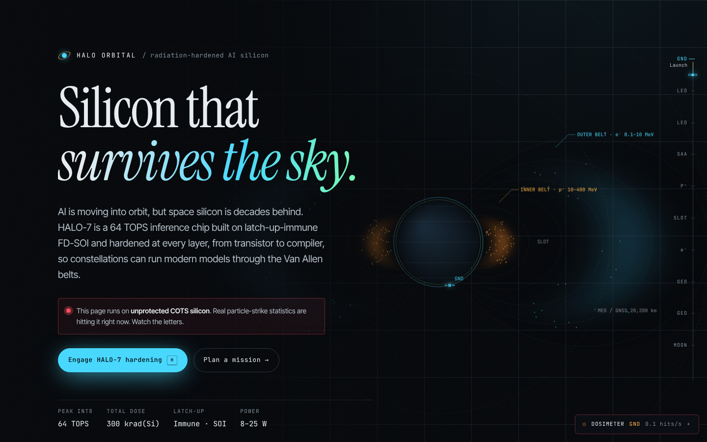
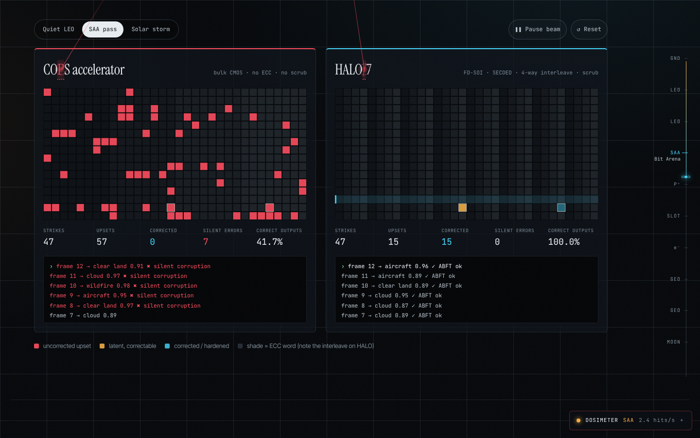
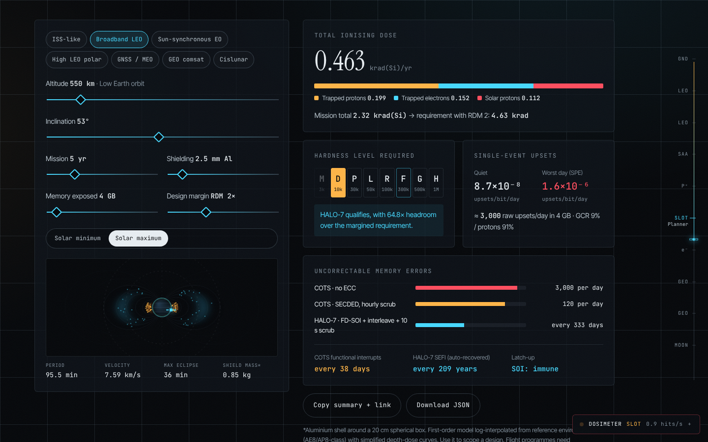

<div align="center">

# HALO Orbital

### Silicon that survives the sky

**Radiation-hardened AI chips for orbit: an interactive thesis, live fault-injection arena and mission radiation planner.**



</div>

---

## The idea

AI is moving into orbit, but space silicon is decades behind. Flagship missions still fly a hardened
PowerPC 750. Commercial GPUs deliver hundreds of TOPS but flip bits silently, hang and can latch up.
**HALO Orbital** is a concept company building **HALO-7**, a 64 TOPS INT8 inference SoC on latch-up-immune
22 nm FD-SOI. It is hardened at every layer:

| Layer | How |
| --- | --- |
| **Process** | FD-SOI: no PNPN latch-up path, about 60× less charge collection than bulk |
| **Architecture** | ABFT checksums on every GEMM, TMR only on control, SECDED with 4-way interleave and 10 s scrubbing |
| **Adaptation** | On-die SEU/TID sensor shifts Performance → Lockstep → Storm (64 → 32 → 20 TOPS) in the SAA or a solar storm |
| **Software** | HaloStack compiler (fault-aware quantisation, ABFT insertion) and HaloSim radiation digital twin |

Read the full **[investment thesis](docs/THESIS.md)**, the **[original brief](docs/PROMPT.md)** and the
**[radiation model](docs/RADIATION_MODEL.md)**.

## What makes the experience different

- **The page is the radiation test.** A Poisson strike engine fires simulated particles at the page while
  you read. On *COTS* silicon, letters bit-flip (hover one to see which bit and its hex code) and whole
  sections can **latch up** until you power-cycle them. Engage **HALO-7** (press `H`) and strikes are
  deflected or corrected by ECC in real time.
- **Scrolling is an ascent.** The altitude rail maps each section to a band of the magnetosphere: launch
  pad → LEO → South Atlantic Anomaly → inner belt → slot → MEO → GEO → cislunar. Flux follows your altitude.
- **A live magnetosphere.** A dipole-field cross-section with proton and electron Van Allen belts,
  bouncing trapped particles and your spacecraft's orbit.
- **The Dosimeter HUD.** Pin any environment (including a solar particle event), watch counters, turn on
  Geiger clicks, pause. Keyboard: `H` silicon · `P` pause · `1`–`9` pin orbit · `0` auto.

## Sections

| # | Section | What you can do |
| --- | --- | --- |
| 01 | **The idea** | Problem, insight, product stack |
| 02 | **Atlas of radiation effects** | TID, DDD, SEU, MBU, SET, SEFI, SEL, SEB: mechanism, metric, standard, mitigation. **Fire an ion** through bulk vs FD-SOI vs DICE and see collected charge versus Q_crit |
| 03 | **Bit Arena** | Identical strikes on a COTS memory and a HALO memory, with SEFIs, silent data corruption, interleaved ECC words, a live scrubber and an inference log |
| 04 | **Inside HALO-7** | Clickable die floorplan, adaptive hardening tied to your current orbit, power → radiator area |
| 05 | **Mission planner** | Any orbit: TID breakdown, MIL-PRF-38535 RHA level with margin, SEU rates, uncorrectable errors per protection scheme, SEFI, eclipse, shield mass. Shareable URL, copy summary, JSON export |
| 06 | **Downlink math** | Why compute in orbit: useful data delivered, bent pipe vs onboard triage, latency |
| 07 | **Landscape** | Compute vs TID chart and table of space processors |
| 08 | **Criteria** | The standards for qualification: TM1019, JESD57/234/89, ESCC, ECSS-Q-ST-60-15C, QML-V/Y, ASTM E595, GEVS, SpaceWire/SpaceFibre, VITA 78 |
| 09 | **The company** | Segments, business model, roadmap, risks |




## Run it

```bash
npm install
npm run dev        # http://localhost:5173
npm test           # unit tests for the physics model
npm run build      # static build in dist/
```

Requires Node 18+. No backend and no tracking; everything runs in the browser.

### Deploy
`.github/workflows/ci.yml` type-checks, tests and builds on every push. On `main` it deploys to
**GitHub Pages**: enable it once under *Settings → Pages → Source: GitHub Actions*. The build uses a relative
base, so `dist/` also works on any static host (Netlify, Vercel, S3).

## Project structure

```
src/
  lib/
    orbit.ts            two-body orbital mechanics, eclipse, dipole L-shell
    radiation.ts        TID, RHA levels, SEU rates, ECC/scrub maths, thermal
    downlink.ts         onboard-triage vs bent-pipe model
    radStore.ts         page-wide strike engine + store (useSyncExternalStore)
    regimes.ts          orbital environments and demo flux
    radiation.test.ts   14 unit tests (Vitest)
  components/           Hero, Magnetosphere, Dosimeter, AltitudeRail, FlipText,
                        StrikeOverlay, Atlas, IonStrike, BitArena, ChipExplorer,
                        MissionPlanner, Downlink, Landscape, Qualification, Business
  styles/global.css     design system (tokens, layout, responsive)
docs/
  PROMPT.md             the brief this project answers
  THESIS.md             YC-style company memo
  RADIATION_MODEL.md    equations, assumptions, references
```

## Accessibility and quality
- Screen readers always get the original text (corrupted glyphs are `aria-hidden`).
- `prefers-reduced-motion` lowers strike rate and removes tracks and animation.
- Every control works from the keyboard; the die blocks and chart points are focusable.
- Responsive down to 360 px with no horizontal scroll. Type-checked with TypeScript `strict`.

## Honesty notes
HALO Orbital is a **concept**. HALO-7 specifications are **design targets**. The radiation model is a
**first-order estimate** for learning and scoping. Flight programmes need SPENVIS/OMERE (AE9/AP9,
SHIELDOSE-2, CREME96) and beam testing. Competitor figures are approximate public numbers; consult vendor
datasheets.

## License
MIT
